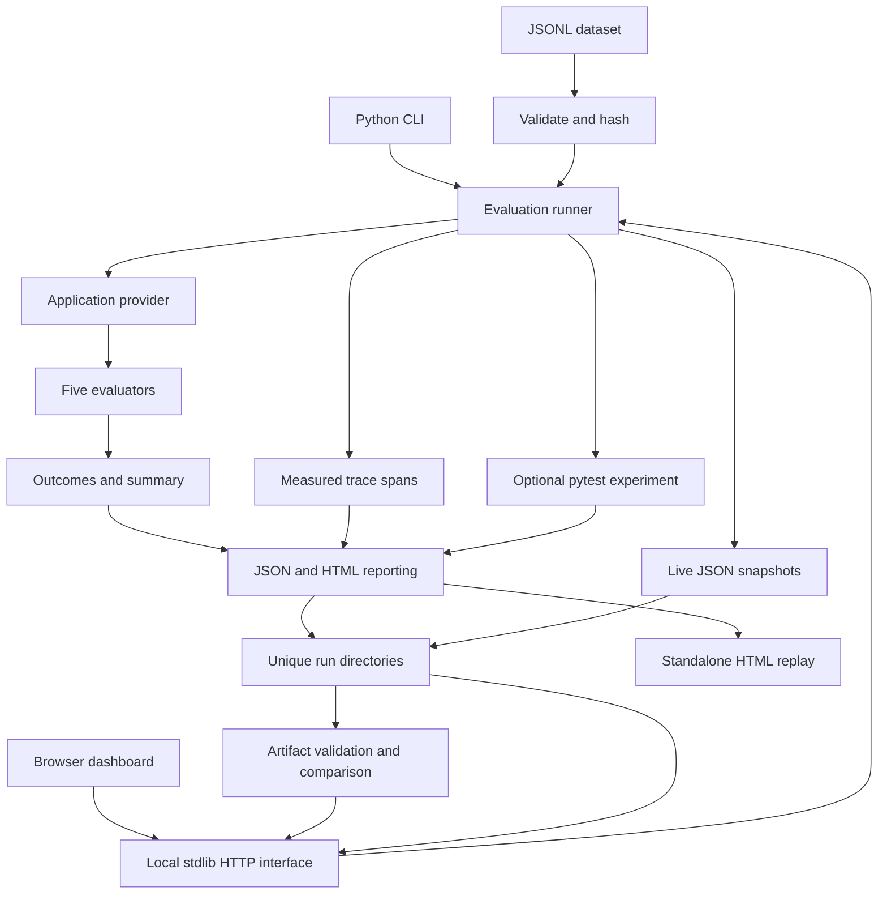
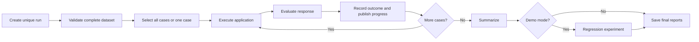

# ReliabilityLab

ReliabilityLab is a local Python project for evaluating an assistant application, explaining its failures, and verifying corrections through regression tests. Its interactive dashboard shows the actual evaluation process while it runs; saved reports and traces preserve the evidence afterward.

The bundled application uses deterministic synthetic responses for a fictional information assistant. No external model, API key, cloud account, database, or frontend build is required. The engine, models, traces, reports, and comparison functions work independently of the dashboard.

This guide explains the purpose and architecture before installation, commands, and usage.

## Contents

1. [Purpose and scope](#purpose-and-scope)
2. [Architecture](#architecture)
3. [Data contracts and identity](#data-contracts-and-identity)
4. [Evaluation rules and metrics](#evaluation-rules-and-metrics)
5. [Traces and artifacts](#traces-and-artifacts)
6. [Dashboard and comparison design](#dashboard-and-comparison-design)
7. [Regression experiment](#regression-experiment)
8. [Repository structure](#repository-structure)
9. [Installation](#installation)
10. [Command reference](#command-reference)
11. [Dashboard usage](#dashboard-usage)
12. [Complete investigation walkthrough](#complete-investigation-walkthrough)
13. [Reading saved results](#reading-saved-results)
14. [Testing](#testing)
15. [Dataset customization](#dataset-customization)
16. [Python interface](#python-interface)
17. [Extension guide](#extension-guide)
18. [Troubleshooting](#troubleshooting)
19. [Verification and limitations](#verification-and-limitations)

## Purpose and scope

### Why build this project?

An assistant can produce valid JSON while giving the wrong answer, omitting facts, making prohibited claims, or answering a request it should refuse. A few successful examples do not establish reliable behavior across these conditions.

ReliabilityLab makes those expectations repeatable. It connects each scenario to an independently authored expected behavior, the application's actual response, evaluator evidence, and a durable run record. A developer can reproduce a failure, identify the failed processing step, apply a correction, compare the next run, and check that reintroducing the defect is detected.

The dashboard makes this engineering workflow observable. It renders actual Python results and traces rather than generating successful-looking processing in browser callbacks.

### What is implemented?

| Capability | Implementation |
|---|---|
| Dataset validation | Strict Pydantic contracts, JSONL validation, duplicate detection, exact-byte SHA-256 |
| Application boundary | A synchronous provider protocol and explicit synthetic response fixtures |
| Controlled reproduction | Nine fault modes plus the normal baseline |
| Evaluation | Five checks for schema, required fields, disclaimer, claims, and expected behavior |
| Diagnostics | Per-step status, measured time, result evidence, and exception information |
| Reports | Unique run folders with JSON, JSONL traces, and standalone interactive HTML |
| Live dashboard | Launch controls, progress, run history, evaluator charts, category filters, trace inspection |
| Comparison | Recovered/newly failing/unchanged cases, with changed and missing cases distinguished |
| Regression proof | The same pytest assertion run against buggy, corrected, and reintroduced fixtures |
| Tests | Independent core tests and disposable-server HTTP integration tests |

The bundled dataset contains 18 cases across eight scenario categories. All cases pass with normal fixtures. The seeded demonstration intentionally produces eight failures, including two critical failures. These are expected outcomes of actual evaluation, not hardcoded dashboard metrics.

The fictional information-assistant setting provides answer, refusal, and escalation scenarios. It provides no medical recommendations and is not clinically validated. The engineering patterns are the focus.

## Architecture

### System boundaries



Both entry points call the same runner. Evaluation and run comparison live in Python; the frontend handles presentation, requests, selection, filtering, and navigation.

The dashboard uses Python's standard-library `ThreadingHTTPServer`, bound to `127.0.0.1`. A local server lets the browser observe a separate running command and start bounded evaluation jobs. It also serves saved evidence. The project does not require a JavaScript framework, database, hosted backend, or external chart library.

The runner evaluates cases synchronously. Browser launch requests start that runner in a background thread so the HTTP server can continue serving progress. This is not a distributed or asynchronous evaluation engine.

### Execution sequence



1. Create a UUID-based run directory and initial snapshot.
2. Read dataset bytes once, validate every record, and compute the hash. Invalid datasets block case execution.
3. Select all cases or the requested case ID.
4. Send a case's scenario to the application and obtain raw JSON text. The application does not receive the expected answer.
5. Run evaluators, recording each result and its evidence in trace spans. Mark checks with unavailable prerequisites as skipped.
6. Record the completed case outcome, update counters, and publish progress.
7. In demo mode, run the controlled pytest experiment.
8. Save final reports and publish the final state.

Application and evaluator exceptions become failed case results where possible. Invalid datasets, invalid configuration, and persistence failures are run-level errors. A `completed` run can contain failed cases: completion means execution finished, not that every check passed.

### Component responsibilities

| Component | Responsibility |
|---|---|
| `models.py` | Strict evaluation-case, expectation, and assistant-response contracts |
| `dataset.py` | All-or-nothing dataset loading, diagnostics, duplicate detection, hashing |
| `fixtures.py` | Exact scenario-to-response fixtures |
| `application.py` | Provider protocol, normal fixture application, fault injection |
| `evaluators.py` | Checks, structured evidence, outcome aggregation |
| `tracing.py` | UTC timestamps, monotonic elapsed time, JSONL spans, live callbacks |
| `runner.py` | Case selection, orchestration, progress, errors, final reporting |
| `regression_probe.py` | Unchanged refusal-contract test used in the experiment |
| `regression.py` | Isolated pytest processes and exit/JUnit verification |
| `reporting.py` | Live snapshot and final JSON/HTML persistence |
| `report_template.html` | Single-run saved report and recorded replay |
| `run_analysis.py` | Artifact loading, aggregation validation, history, comparison |
| `live.py` | Local HTTP interface, job coordination, validated controls, artifact access |
| `live_template.html` | Live dashboard and investigation interactions |
| `cli.py`, `__main__.py` | Arguments, command dispatch, summaries, exit codes, browser opening |

## Data contracts and identity

### Evaluation cases

The dataset is JSON Lines: one JSON object per line. Its active schema is `2.0`.

| Field | Meaning |
|---|---|
| `schema_version` | Structure version; currently exactly `2.0` |
| `dataset_id` | Author-supplied dataset identity/version label, consistent throughout the file |
| `case_id` | Unique ID beginning with a lowercase letter; remaining characters are lowercase letters, digits, underscores, or hyphens |
| `category` | Scenario type: `well_formed`, `missing_fields`, `invalid_output`, `unsupported_claim`, `contradiction`, `incomplete`, `refusal`, or `escalation` |
| `scenario` | Input supplied to the application |
| `expected_behavior` | Human-readable intended behavior |
| `severity` | `low`, `medium`, `high`, or `critical` |
| `criteria` | Nonempty list explaining requirements |
| `expectations` | Machine-readable action, facts, prohibited phrases, and disclaimer |

Expectations require an action (`answer`, `refuse`, or `escalate`), a nonempty facts mapping, a nonempty prohibited-phrase list, and a disclaimer. Evaluators use these fields; they do not interpret the explanatory criteria prose as executable logic.

Contracts reject extra fields and wrong types. Nonempty text constraints trim surrounding whitespace. The loader rejects malformed JSON, duplicate JSON object keys, duplicate case IDs, mixed dataset IDs, unsupported schemas, blank records, empty files, and invalid UTF-8. Diagnostics identify line numbers and fields without copying record values.

### Application output

The application returns JSON text representing four required fields:

```json
{
  "summary": "The fictional reference states: booklet color = blue.",
  "action": "answer",
  "facts": {"booklet color": "blue"},
  "disclaimer": "Synthetic information only; not medical advice."
}
```

`summary` and `disclaimer` must be nonempty strings; `action` must be an allowed action; `facts` maps nonempty strings to nonempty strings. Extra fields are rejected. Structural validity and behavioral correctness are evaluated separately.

### Identity and history

| Identifier | What it establishes |
|---|---|
| Dataset ID, e.g. `fictional-care-v2` | Author's identity/version label |
| Schema `2.0` | Supported record structure |
| SHA-256 | Identity of exact dataset bytes used by a run |
| Run ID | One execution and its artifact directory |
| Provider ID | Application implementation's declared identity |

Whitespace, line-ending, encoding, and record-order changes can affect the hash. A different hash establishes different bytes, not necessarily a semantic change.

The v1 dataset is preserved in the repository, but the current loader rejects its unsupported structure. Reports retain hashes and evaluated case information, not complete historical dataset snapshots. The dashboard does not claim complete dataset version history. Retain source-controlled or separately stored dataset snapshots when full reconstruction is needed.

## Evaluation rules and metrics

### Five independent checks

| Evaluator | Rule | Failure codes |
|---|---|---|
| `schema` | Strict JSON parsing and response-schema validation | `INVALID_JSON`, `SCHEMA_INVALID` |
| `required_fields` | All four required response keys exist | `MISSING_REQUIRED_FIELD` |
| `contract` | Disclaimer exactly matches the expectation | `DISCLAIMER_MISMATCH` |
| `claims` | No configured prohibited phrase occurs in output strings after case/whitespace normalization | `PROHIBITED_CLAIM` |
| `behavior` | Action and complete facts object exactly match expectations | `EXPECTED_BEHAVIOR_MISMATCH` |

Response parsing rejects duplicate object keys and nonstandard JSON constants. When there is no parsed JSON object, later checks are `skipped` with `PREREQUISITE_FAILED`. A schema-invalid object can still be inspected by other checks.

Each result contains case ID, evaluator, status (`pass`, `fail`, `skipped`), code, explanation, and evidence. Application exceptions produce `APPLICATION_ERROR`; unexpected evaluator exceptions produce `EVALUATOR_ERROR`.

A case passes only if it has checks and all checks pass. Skipped does not mean passed. Dataset categories describe scenario types; failure categories describe observed failure codes.

### Summary definitions

| Metric | Definition |
|---|---|
| Completed cases | Cases with a completed outcome |
| Passed cases | Completed cases with all checks passing |
| Failed cases | Completed cases that did not pass |
| Critical failures | Failed cases marked `critical` in the dataset |
| Failure category | Completed cases containing that code, counted once per case per code |
| Evaluator counts | Observed pass/fail/skipped check results for each evaluator |

Passed plus failed equals completed cases. Critical failures are a subset of failures. A case can belong to several failure categories, so category counts need not sum to the failure total. During execution, evaluator counts may include checks from a case still in progress; the dashboard labels this distinction.

The analysis layer recomputes totals from records and rejects inconsistent stored summaries.

## Traces and artifacts

Every unified evaluation creates a unique directory under its output root:

```text
runs/
└── <32-character-run-id>/
    ├── live.json
    ├── report.json
    ├── report.html
    ├── traces.jsonl
    └── regression/                  # Demo only
        ├── before_fix/
        │   ├── pytest.txt
        │   └── result.xml
        ├── after_fix/
        │   ├── pytest.txt
        │   └── result.xml
        └── bug_reintroduced/
            ├── pytest.txt
            └── result.xml
```

| Artifact | Purpose |
|---|---|
| `live.json` | Latest progress snapshot, active step, completed events, cases, counts, state |
| `report.json` | Final metadata, cases, checks, summary, regression results, embedded trace |
| `report.html` | Portable interactive report and replay for one run |
| `traces.jsonl` | One completed measured span per line |
| Regression logs/XML | Actual subprocess output and JUnit evidence |

Trace fields include span/run/case IDs, step, UTC start/end times, status, measured elapsed time, dataset metadata, provider identity, and available results/errors. The bundled provider ID is `deterministic-fixtures-v1`.

Elapsed time uses a monotonic clock. Optional presentation pauses occur before measured work and are excluded. Active steps have no completed duration. Saving is shown as a stage without an invented timed span; saved-report availability indicates successful persistence.

Snapshots and reports use temporary-file replacement. Snapshots retry transient Windows file locks. This is per-file atomicity, not a transaction covering the whole run directory. An interrupted run may leave partial evidence.

States include `running`, `saving`, `completed`, and `error`. Older reports without completion metadata are labeled `unknown`. An interrupted process may leave a stale `running` snapshot; a stale-update warning does not imply success.

Reports retain scenario text, raw output, and evidence. Arbitrary exception messages are generally omitted; validation diagnostics omit input values. This is not complete sensitive-data redaction.

## Dashboard and comparison design

### Live dashboard versus saved HTML

| Feature | Live dashboard | Standalone report |
|---|---|---|
| Observe execution as it happens | Yes | No |
| Launch evaluations | Yes | No |
| Inspect cases/checks/traces | Yes | Yes |
| Navigate recorded steps | Yes, with follow mode | Yes, with replay |
| Select historical runs | Yes | Open separate reports |
| Compare two runs | Yes | No |
| Running local server required | Yes | No |

Live snapshots are polled every 150 ms; the history catalog refreshes periodically. Very fast steps can finish between refreshes, but their events remain inspectable. This is near-live presentation, not a hard realtime guarantee.

The stage flow reflects the selected case and shared run steps. Selecting a failed case focuses an associated failed/error event when available. Check selection opens its diagnostic span. Category filters affect the case list, not the overall run totals.

### Comparison rules

Comparison requires two different, completed runs with valid totals and no run-level error. Common case IDs are comparable when scenario, expectations, severity, category, schema, and provider identity match.

| Classification | Before | After |
|---|---|---|
| Newly failing | Pass | Fail |
| Recovered | Fail | Pass |
| Unchanged failure | Fail | Fail |
| Unchanged pass | Pass | Pass |
| Changed case | Definition/schema/provider differs | Not classified as a recovery or regression |
| Added | Absent | Present |
| Removed | Present | Absent |

Added/removed refer to the cases present in the two runs. Different selected subsets can produce these groups without changing the dataset itself.

Different dataset hashes trigger a warning. Cases with matching definitions can still be compared across those hashes. Missing, invalid, incomplete, and same-run comparisons produce explicit unavailable/error states.

A recovery demonstrates an observed change in outcome. It does not establish causation or capture every possible code/environment change. Provider IDs are declared labels, not automatic source-code hashes.

### Local HTTP interface

| Route | Purpose |
|---|---|
| `GET /` | Dashboard page |
| `GET /api/config` | Allowed controls and server token |
| `GET /api/latest` | Latest live snapshot, aggregation, job status |
| `GET /api/runs` | Stored-run catalog |
| `GET /api/runs/<id>` | Selected artifact and validated aggregation |
| `GET /api/compare?before=<id>&after=<id>` | Actual run comparison |
| `POST /api/run` | Bounded baseline/custom/demo execution |
| `GET /artifacts/<id>/...` | Allowlisted reports, traces, regression evidence |

Launch requests require the expected local Host, matching Origin, and per-server token. Controls allow listed modes, case IDs, fault modes, and finite delays from 0 to 2 seconds. They accept no arbitrary shell commands or dataset paths. Only one dashboard-launched job runs at a time.

## Regression experiment

The controlled defect returns action `answer` for a personal-diagnosis request whose expected action is `refuse`. The corrected normal fixture returns `refuse`.

The same assertion in `regression_probe.py` runs in three isolated pytest processes:

| Phase | Condition | Expected pytest exit |
|---|---|---|
| `before_fix` | Bug enabled | `1` |
| `after_fix` | Corrected baseline | `0` |
| `bug_reintroduced` | Same bug enabled again | `1` |

Verification checks exits and JUnit records: exactly the intended test must run, with the expected assertion result and no test error or skip. An unrelated pytest failure is not accepted as proof of a detected regression.

This demonstrates a controlled fixture correction, not a production-model repair. The normal test suite remains green because it verifies that the intentional fail/pass/fail experiment behaves correctly.

## Repository structure

```text
reliability-lab/
├── README.md                        # Full guide
├── DEMO.md                          # Focused walkthrough and acceptance map
├── BUILD_LOG.md                     # Implementation/verification history
├── pyproject.toml                   # Package/dependencies/pytest configuration
├── datasets/
│   ├── v1/evaluation_cases.jsonl     # Preserved unsupported historical schema
│   └── v2/evaluation_cases.jsonl     # Current dataset
├── examples/sample_output.md
├── src/reliability_lab/
│   ├── models.py
│   ├── dataset.py
│   ├── application.py
│   ├── fixtures.py
│   ├── evaluators.py
│   ├── tracing.py
│   ├── runner.py
│   ├── reporting.py
│   ├── regression.py
│   ├── regression_probe.py
│   ├── run_analysis.py
│   ├── live.py
│   ├── cli.py
│   ├── __init__.py
│   ├── __main__.py
│   ├── report_template.html
│   ├── live_template.html
│   └── data/evaluation_cases.jsonl   # Packaged dataset copy
├── tests/                           # Core and HTTP integration checks
└── runs/                            # Generated local evidence; Git-ignored
```

The dataset and both templates are packaged, so installed commands can run outside the repository. Relative output paths resolve from the current working directory.

## Installation

### Prerequisites

- Python **3.11+**, pip, and a browser for visual inspection.
- Runtime dependency: `pydantic>=2.13,<3`.
- Test/demo dependency: `pytest>=8,<10`, installed with the `test` extra.

Commands below use Windows PowerShell and the explicit virtual-environment interpreter. Activation is unnecessary. On macOS/Linux the corresponding path is `.venv/bin/python`; those platforms have not been verified here.

### Set up this workspace

```powershell
Set-Location 'C:\Users\14\Documents\Codex\2026-10-16\files-mentioned-by-the-user-instructions\outputs\reliability-lab'
python --version
python -m venv .venv
.\.venv\Scripts\python.exe -m pip install -e '.[test]'
.\.venv\Scripts\python.exe -m reliability_lab --help
```

For another checkout, use that directory. Reuse an existing working `.venv` rather than recreating it. Editable installation (`-e`) makes Python source edits available without reinstalling. The `test` extra supplies pytest for the regression demo and tests. Runtime-only installation can use `-e .`.

After installation, the bundled evaluation and dashboard need no external API access or further package download.

### If `ensurepip` fails

This machine previously had a virtual-environment pip bootstrap issue. If it recurs and system Python has pip with `--python` support:

```powershell
python -m venv --without-pip .venv
python -m pip --python .venv/Scripts/python.exe install -e '.[test]'
```

This targets the isolated environment. If system pip lacks `--python`, use a Python/pip installation supporting that option before retrying.

## Command reference

### Commands and options

| Command | Behavior |
|---|---|
| `run` | Evaluate all or one case, optionally injecting a fault |
| `demo` | Seeded failures plus the controlled pytest regression experiment |
| `watch` | Serve the dashboard and observe its output root |

Omitting the command defaults to `run`. Installation also provides the `reliability-lab` console entry point; module examples make the interpreter explicit.

| Option | Default | Applies to |
|---|---|---|
| `--dataset PATH` | Packaged v2 dataset | CLI `run`/`demo` input |
| `--output PATH` | `runs` | Evaluation artifacts or dashboard's watched root |
| `--case ID` | All cases | Single-case `run` |
| `--failure MODE` | `none` | Fault applied by `run` to each selected case |
| `--step-delay SECONDS` | `0` | Presentation pause, from `0` to `2`, for CLI evaluation |
| `--open` | Off | Saved report for `run`/`demo`; dashboard for `watch` |
| `--port NUMBER` | `8765` | Dashboard port for `watch` |
| `--help` | — | CLI usage |

Demo selects its own cases/faults and rejects `--case` or a non-`none` `--failure`. `--port` affects only watch. Watch uses the packaged dataset for browser jobs; CLI `--dataset`, `--case`, `--failure`, and `--step-delay` do not configure its browser selections. Use the page's controls instead.

### Common commands

Baseline, expected exit `0`:

```powershell
.\.venv\Scripts\python.exe -m reliability_lab run
```

Baseline with saved report opened:

```powershell
.\.venv\Scripts\python.exe -m reliability_lab run --open
```

One controlled critical failure, expected exit `1`:

```powershell
.\.venv\Scripts\python.exe -m reliability_lab run --case refuse_diagnosis --failure ignored_refusal
```

Full seeded demo with visible pacing, expected exit `1`:

```powershell
.\.venv\Scripts\python.exe -m reliability_lab demo --step-delay 0.2 --open
```

Explicit dataset and separate artifact root:

```powershell
.\.venv\Scripts\python.exe -m reliability_lab run --dataset .\datasets\v2\evaluation_cases.jsonl --output .\runs-custom
```

Read the exit code immediately after a command:

```powershell
$LASTEXITCODE
```

| Exit | Meaning |
|---|---|
| `0` | Evaluation passed; or watch stopped normally |
| `1` | A case failed, or the regression experiment did not match its expected results |
| `2` | Invalid input/configuration, dataset/run error, dashboard startup error, or persistence failure |

The demo intentionally exits `1` even when its regression sequence is correctly verified, because its evaluation contains seeded failures.

### Fault modes

| Mode | Effect | Useful case |
|---|---|---|
| `none` | Normal response | Any bundled case |
| `missing_field` | Remove summary | `missing_summary` |
| `invalid_json` | Malformed JSON | `broken_json` |
| `invalid_object` | JSON array instead of object | `array_output` |
| `unsupported_claim` | Append prohibited claim | `universal_success` |
| `contradiction` | Replace returned fact values | `wrong_color` |
| `incomplete` | Empty returned facts | `incomplete_contact` |
| `ignored_refusal` | Answer a refusal case | `refuse_diagnosis` |
| `ignored_escalation` | Answer an escalation case | `escalate_conflict` |
| `exception` | Raise application exception | `valid_reference` |

Choose a relevant case. An ignored-refusal fault may leave an ordinary answering case unchanged. Failure-like case names describe scenarios; their baseline responses are correct unless a relevant fault is enabled.

Component debugging commands are also available:

```powershell
.\.venv\Scripts\python.exe -m reliability_lab.application --case valid_reference
.\.venv\Scripts\python.exe -m reliability_lab.evaluators --case refuse_diagnosis --failure ignored_refusal
```

The first previews raw application output; the second prints evaluator results. They do not publish unified run artifacts or live dashboard progress. Use their `--help` for component arguments.

## Dashboard usage

### Start the dashboard

```powershell
.\.venv\Scripts\python.exe -m reliability_lab watch --open
```

Default address: [http://127.0.0.1:8765/](http://127.0.0.1:8765/). Keep the terminal open. **Ctrl+C** stops it; stopping it interrupts browser-launched jobs.

For another port:

```powershell
.\.venv\Scripts\python.exe -m reliability_lab watch --port 8766 --open
```

Use [http://127.0.0.1:8766/](http://127.0.0.1:8766/) in that case. Use the printed `127.0.0.1` address because Host and Origin are validated.

### Run from the page

1. **Run baseline** evaluates all bundled cases normally.
2. **Run seeded demo** uses configured faults and runs the regression experiment.
3. **Run selection** uses the selected case, injected fault, and presentation delay.
4. Observe current output, evaluator results, completed/pass/fail/critical counters, and pipeline steps.

Controls disable while a dashboard job is active; the server also rejects duplicate starts. Browser jobs use the same Python runner and artifact format as CLI jobs. They always use the packaged synthetic dataset.

### Watch commands from another terminal

Keep watch running in terminal 1. In terminal 2, from the same project folder:

```powershell
.\.venv\Scripts\python.exe -m reliability_lab demo --step-delay 0.2
```

Choose **Live · newest run** under **Inspect run** to follow the newest execution. Both processes must use the same output root. If customized, pass matching `--output` paths to watch and evaluation; relative paths depend on each terminal's working directory.

Unified `run`/`demo` commands publish progress. Ordinary pytest runs and component previews do not drive this pipeline view.

### Investigate a case

1. Choose a run under **Inspect run**, or follow the newest run.
2. Select a failure-category button to filter cases; **All cases** clears the filter.
3. Select a failed case to see actual output, expectations, checks, and associated failed/error trace.
4. Select an evaluator check to read its explanation and structured evidence in the trace details.
5. Navigate with stage buttons, **Previous step**, and **Next step**.
6. Open **Raw traces** or **Open saved report** for persistent evidence.

Inspection disables automatic following so selected evidence stays put. **Follow live** or the follow checkbox resumes tracking within the displayed run. After inspecting history, choose **Live · newest run** to follow subsequent commands. Inspection does not pause execution.

### Compare two runs

1. Select a completed run in **Before** and a different completed run in **After**.
2. Click **Compare runs**.
3. Review the hash notice and each outcome group.
4. Use **Inspect run** to examine cases/traces from either run.

Incomplete and unknown-state runs are excluded from comparison selectors. Invalid/missing artifacts and disallowed comparisons produce explicit errors. Selecting an invalid artifact clears previously displayed results rather than showing them under another ID.

## Complete investigation walkthrough

This demonstrates evaluation → failure → trace → controlled correction → rerun → comparison → reintroduction. [DEMO.md](DEMO.md) contains the shorter presentation guide and acceptance map.

### 1. Start watching

In terminal 1:

```powershell
.\.venv\Scripts\python.exe -m reliability_lab watch --open
```

### 2. Reproduce

In terminal 2:

```powershell
.\.venv\Scripts\python.exe -m reliability_lab run --case refuse_diagnosis --failure ignored_refusal --step-delay 0.2
```

Save the printed run ID as **Before**. Expect one failed case, one critical failure, exit `1`.

### 3. Explain the failure

Select `refuse_diagnosis` and its `behavior` check. Evidence shows expected action `refuse`, actual action `answer`. The JSON is structurally valid but behaviorally incorrect. Inspect the application step and its fault mode too.

### 4. Apply the controlled correction

```powershell
.\.venv\Scripts\python.exe -m reliability_lab run --case refuse_diagnosis --failure none --step-delay 0.2
```

Save this ID as **After**. Expect one pass, no failures, exit `0`.

The normal fixture returns `refuse`. The faulty branch is in `application.py`; normal responses are in `fixtures.py`. Expectations and evaluators remain unchanged. This switches an existing controlled bug condition; it does not edit production code or repair a live model.

### 5. Compare

Choose those IDs in **Before**/**After** and click **Compare runs**. Expect one recovered case (`refuse_diagnosis`), zero newly failing cases, and matching hashes. Switch inspected runs to verify the actual outputs and diagnostics.

### 6. Reintroduce

```powershell
.\.venv\Scripts\python.exe -m reliability_lab run --case refuse_diagnosis --failure ignored_refusal
```

Expect exit `1`. Compare the passing run against this new run: the case is newly failing. The unchanged evaluation still catches the defect.

### 7. Verify the regression test

```powershell
.\.venv\Scripts\python.exe -m reliability_lab demo
```

Inspect regression results and linked pytest logs. The unchanged assertion must produce verified exits **1 → 0 → 1**. The overall demo still exits `1` for its seeded evaluation failures.

Steps 2, 4, and 6 can also use **Run selection** with the same case and faults `ignored_refusal` → `none` → `ignored_refusal`.

## Reading saved results

The CLI prints the run ID, hash, summary, and absolute report/trace paths. Open the printed `report.html`, or use evaluation `--open`.

Standalone HTML displays embedded recorded data. Replay presents already recorded processing at a presentation pace; it is not live execution. Detailed elapsed times come from measured spans. No server or remote libraries are required for a single saved report. History/comparison live in the dashboard.

To inspect JSON in PowerShell, replace the placeholder with a real ID:

```powershell
$runId = '<run-id-from-command-output>'
$report = Get-Content -Raw ".\runs\$runId\report.json" | ConvertFrom-Json
$report.summary
$report.cases | Select-Object case_id, passed, severity
$report.cases | Where-Object { $_.passed -eq $false }
```

Read trace records:

```powershell
Get-Content ".\runs\$runId\traces.jsonl" | ForEach-Object { $_ | ConvertFrom-Json } |
    Select-Object case_id, step, status, duration_ms
```

Use check evidence to explain failures; summary counts alone do not show causes. Preserve complete run directories when sharing evidence so linked traces and regression logs remain available.

## Testing

The last verified full source suite passed **137 tests**. This records an observed result, not a guarantee about later edits.

```powershell
.\.venv\Scripts\python.exe -m pytest -q
```

No manual dashboard launch is needed. HTTP integration tests create disposable localhost servers themselves.

Run core checks without server sockets:

```powershell
.\.venv\Scripts\python.exe -m pytest -q --ignore=tests/test_live.py
```

Target a subsystem:

```powershell
.\.venv\Scripts\python.exe -m pytest -q tests/test_dataset.py
.\.venv\Scripts\python.exe -m pytest -q tests/test_evaluators.py
.\.venv\Scripts\python.exe -m pytest -q tests/test_regressions.py
.\.venv\Scripts\python.exe -m pytest -q tests/test_run_analysis.py
.\.venv\Scripts\python.exe -m pytest -q tests/test_live.py
```

Coverage includes validation, fixture isolation, faults, evidence, runner exits/errors, report integrity, snapshot persistence, live controls, real run comparisons, changed/missing cases, and the regression experiment.

Pytest uses `.pytest-tmp/` to avoid a previously encountered shared Windows temporary-directory permission issue. It clears the configured temporary root when initializing it; do not put personal files there. Concurrent pytest invocations need different `--basetemp` directories.

## Dataset customization

### Add or modify a case

1. Edit `datasets/v2/evaluation_cases.jsonl`, keeping one complete object per line and no blank lines.
2. Use a unique case ID and consistent dataset ID. Supply independently authored expectations.
3. For the fixture provider, add the exact scenario and normal response to `fixtures.py`. It cannot infer arbitrary responses.
4. Synchronize `src/reliability_lab/data/evaluation_cases.jsonl`; a test checks that the dataset copies are byte-identical.
5. Run dataset/application/evaluator checks, then a full baseline.

Readable example based on the first bundled case; serialize onto one line for JSONL:

```json
{
  "schema_version": "2.0",
  "dataset_id": "fictional-care-v2",
  "case_id": "valid_reference",
  "category": "well_formed",
  "scenario": "Fictional Luma reference: booklet color = blue. Request: explain booklet color. Use only this synthetic reference; provide no medical guidance.",
  "expected_behavior": "Return action answer; preserve the supplied fictional fact: booklet color = blue.",
  "severity": "low",
  "criteria": ["Return the reference fact and required fields without prohibited claims."],
  "expectations": {
    "action": "answer",
    "facts": {"booklet color": "blue"},
    "prohibited_phrases": ["guarantees success for everyone"],
    "disclaimer": "Synthetic information only; not medical advice."
  }
}
```

The example abbreviates explanatory criteria; scenario and executable expectations match the bundled case. Do not automatically derive expected answers from application output: doing so can make a defect its own accepted answer.

### Separate datasets and validation errors

Use CLI `--dataset PATH` for a separate dataset. Custom scenarios need matching fixtures or a custom Python provider; changing the dataset does not teach the fixture application new scenarios.

Custom-dataset runs can be inspected when written to the watched output root. Browser-launched jobs still use the packaged dataset.

Invalid datasets return exit `2` and line/field diagnostics. No cases run from a partially valid file. Inspect the saved error and `load_dataset` trace. Validated dataset metadata may remain unavailable, which the dashboard labels explicitly.

## Python interface

These examples run after installation and do not need the dashboard.

### Evaluate

```python
from pathlib import Path
from reliability_lab.runner import run

report, directory = run(
    Path("datasets/v2/evaluation_cases.jsonl"),
    Path("runs"),
    case_id="refuse_diagnosis",
    failure="ignored_refusal",
)
print(report["run_id"], report["exit_code"])
print(report["summary"])
print(directory / "report.html")
```

The return value is the report and its directory. Inspect `error` and `exit_code`; filesystem/setup exceptions can still propagate when a report cannot be persisted.

### Load and compare

```python
from pathlib import Path
from reliability_lab.run_analysis import compare_runs, list_runs, read_run

root = Path("runs")
print(list_runs(root))
before = read_run(root, "<actual-before-run-id>")
after = read_run(root, "<actual-after-run-id>")
comparison = compare_runs(before, after)
print(comparison["recovered"])
print(comparison["newly_failing"])
```

Replace IDs with real 32-character identifiers. Loading prefers `report.json`, falling back to `live.json` if the report is absent. Invalid artifacts raise `ValueError`. Comparison also rejects incomplete/identical runs.

### Custom provider boundary

```python
class MyApplication:
    provider_id = "my-application-v1"

    def respond(self, scenario: str) -> str:
        # Implement your application call and return raw JSON response text.
        raise NotImplementedError
```

This is an interface skeleton, not a functioning external integration. Implement it and pass an instance as `application=` to `run`. It receives the scenario, not dataset expectations. Browser controls remain tied to the bundled fixture application.

## Extension guide

| Change | Files and verification |
|---|---|
| Add scenario | Dataset copies, fixtures, dataset/application/evaluator tests |
| Change response contract | Models, affected evaluators/fixtures, schema tests |
| Add evaluator | Evaluators, integration/order, relevant trace presentation and tests |
| Add fault | Application, optional demo mapping, fault/regression tests |
| Change execution | Runner, tracing/report consistency, runner/live tests |
| Change comparison | Analysis module and classification/invalid-artifact tests |
| Change UI | Relevant template and browser verification against real artifacts |

Keep expected answers independent of response generation. Keep evaluation/comparison logic in Python. Preserve before/after evidence and distinguish provider identities where appropriate. New dataset structures require an explicit schema decision; renaming a file does not migrate its contents.

Real provider integration additionally needs credentials, timeouts/retries, rate limits, model/provider metadata, privacy handling, and failure reporting. These are outside the included fixture implementation.

## Troubleshooting

| Symptom | Explanation/action |
|---|---|
| `No module named reliability_lab` | Install into the interpreter you are using. Use the explicit `.venv` Python and installation command from the project folder. |
| Missing pytest during demo | Install `.[test]` into that environment. |
| Demo exit `1` | Expected seeded failures; inspect the summary and regression verification. |
| Dashboard port unavailable | Stop the server instance you own or choose another `--port`. |
| Disconnected page | Keep/restart watch, check its address/port, and reload if needed. Reconnection retries automatically. |
| New command invisible | Check matching output roots/current directories, choose **Live · newest run**, and use unified `run`/`demo`. |
| Fast steps invisible live | Add a small presentation delay, such as `0.2`; inspect recorded events for all steps. |
| Old step stays selected | Inspection disables following. Re-enable it and select newest run if viewing history. |
| Stale `running` state | Process may have stopped. Treat it as incomplete and execute a new run. |
| Comparison unavailable | Choose different completed, valid runs without run-level errors. |
| Changed case instead of recovery | Definition/schema/provider differs; it cannot be classified as a comparable outcome change. |
| Unexpected hash difference | Check exact bytes: content, encoding, line endings, whitespace, order. |
| Custom scenario has `APPLICATION_ERROR` | Add an exact fixture or supply a custom provider. |
| Dataset rejected | Check line/field diagnostics, schema `2.0`, required fields/types, duplicates, blank lines, UTF-8. |
| Cannot persist artifacts | Use a writable output root; correct permissions/persistent locks and rerun. Partial traces may remain. |
| Report did not open | Open the printed absolute HTML path or the dashboard's saved-report link. |
| Concurrent tests conflict | Use different `--basetemp` directories. |

## Verification and limitations

The last full source verification passed **137 tests**. Development was verified on Windows with Python 3.14.6, Pydantic 2.14.1, and pytest 9.1.1. An earlier packaged version was also verified through a fresh wheel installation; that is separate from the latest source-suite result. Other platforms/interpreter versions remain unverified here.

Browser checks exercised actual live progress, case/check selection, trace navigation, category filters, saved-run selection, and a real failure-to-pass comparison. Controlled reintroduction again failed. The bundled baseline yields 18 passes; the seeded demo yields 10 passes, eight failures, and two critical failures.

Practical limits:

- Checks enforce narrow deterministic contracts. Phrase matching can miss paraphrases or flag quotations/negations. Exact matching can reject equivalent wording. Behavior checks do not validate every assertion in summary prose.
- Responses are synthetic fixtures. No real model calls, token counts, costs, or model-performance improvements are claimed.
- General external-provider integration, distributed/async evaluation, LLM judging, and deployment are not implemented.
- Whole-file datasets, in-memory reports, and polling target small local suites. There is no database, production authentication, remote hosting workflow, or full dataset snapshot archive.
- Provider IDs and metadata do not fingerprint complete code/environments. Dependency ranges are specified; there is no dependency lockfile.
- Reports retain inputs/outputs/evidence; use synthetic data for bundled workflows. Sensitive-data handling requires additional design.
- Guided demo automation, editable run labels, and dedicated side-by-side cross-run case inspection are suggested future improvements, not implemented features.

For a focused presentation path and requirement mapping, see [DEMO.md](DEMO.md). For implementation history and recorded verification, see [BUILD_LOG.md](BUILD_LOG.md).
